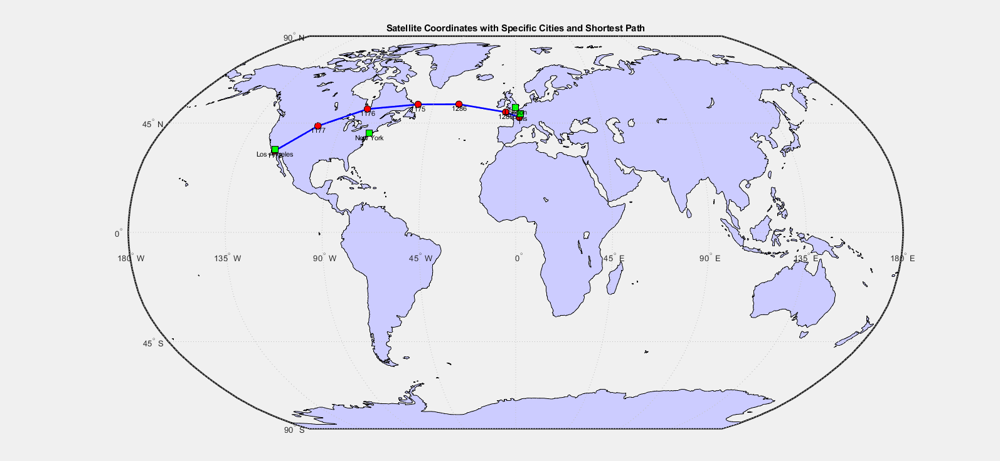
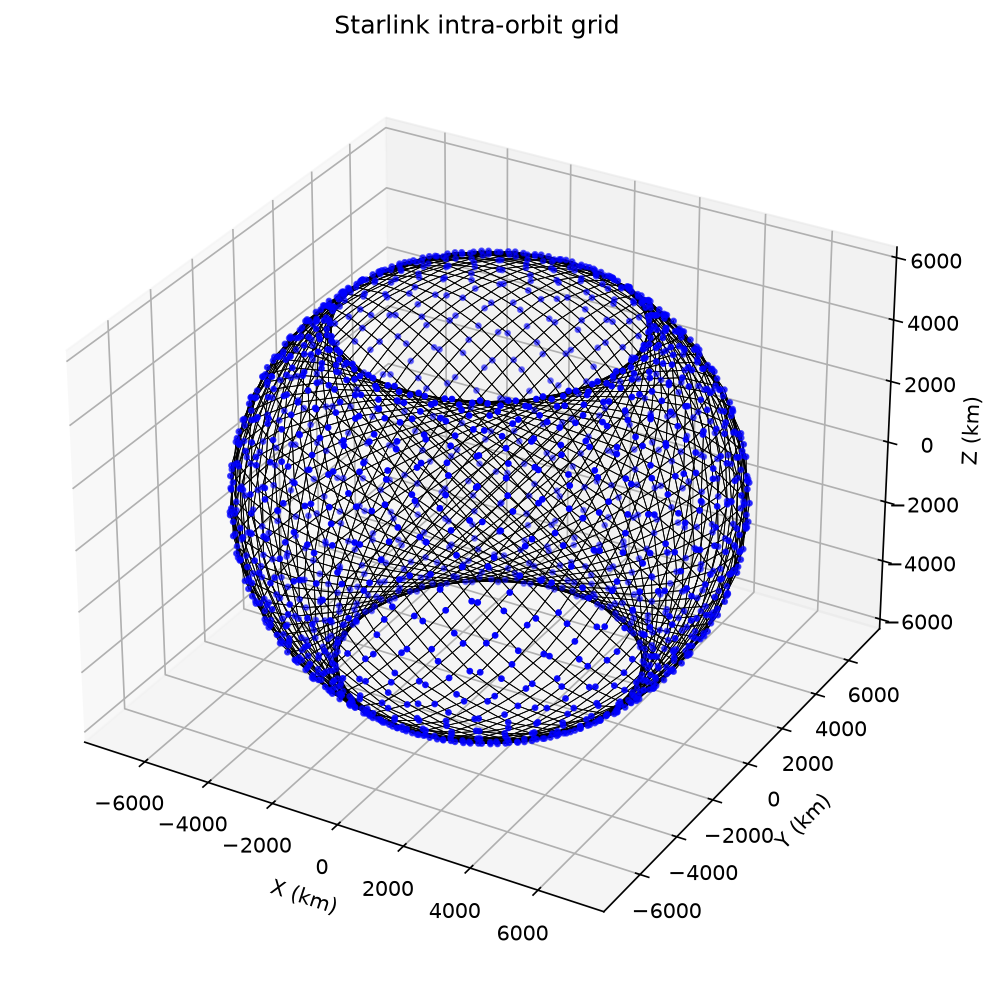

# LEO Satellite Routing

Joint project at Université Paris-Saclay (Ahmad Atwi, Ahmad Harakeh, Jamil Abou Ltaif; supervised by Dr. Sahar Hoteit
and Dr. Alexis Aravanis) on routing over LEO mega-constellations.

We extracted satellite positions for Starlink, Project Kuiper and Telesat from the [SaVi](https://savi.sourceforge.io/)
simulator, built an inter-satellite link graph for each constellation, and used Dijkstra to find the shortest path
between Paris and Los Angeles. From that path we computed the round-trip time.



*Starlink: Paris to Los Angeles in 6 inter-satellite hops (plotted with MATLAB).*

## Results (Paris to Los Angeles)

| Constellation | Satellites | Altitude | Hops | Path length in space | RTT |
|---|---|---|---|---|---|
| Starlink | 1584 (72 planes x 22) | 550 km | 6 | 10,133 km | 75.1 ms |
| Project Kuiper | 1296 (36 planes x 36) | 610 km | 7 | 11,128 km | 85.7 ms |

For comparison, a single GEO satellite hop adds around 240 ms of RTT.

The numbers in the [report](docs/final_report.pdf) are slightly lower (74.9 ms for Starlink). They were computed
before I fixed the ground-to-satellite distance, which wasn't using the actual slant range.

## How it works

1. Convert each satellite's latitude/longitude (from SaVi) to Cartesian coordinates at the shell altitude.
2. Link each satellite to its neighbours in the same orbital plane (intra-orbit grid).
3. Connect any two satellites closer than 2000 km, weighted by distance.
4. Run Dijkstra between the satellite above Paris and the one closest to Los Angeles.
5. RTT = 2 x (uplink + path + downlink) / speed of light.



## Usage

```bash
pip install -r requirements.txt
python src/leo_routing.py starlink
python src/leo_routing.py kuiper --plot
```

Other options: `--src-city` / `--dst-city` (paris, los-angeles, london, new-york), `--source` / `--target` to pick
satellite IDs, `--threshold` for the max link length, `--periapsis` to print periapsis passage times.

```
== Starlink: 1584 satellites, 72 orbits x 22, altitude 550 km
Closest satellite to los-angeles: 1178 (69.2 km)
Shortest path (6 hops): [1, 1285, 1286, 1175, 1176, 1177, 1178]
Space segment distance: 10132.8 km
End-to-end RTT paris <-> los-angeles: 75.147 ms
```

`matlab/plot_shortest_path_starlink.m` draws the world map above (needs the Mapping Toolbox).

## Files

- `src/leo_routing.py`: routing and RTT computation
- `matlab/`: map plot
- `data/`: SaVi exports for each constellation, plus the precomputed Starlink grid
- `docs/final_report.pdf`: full report, including the SaVi setup
